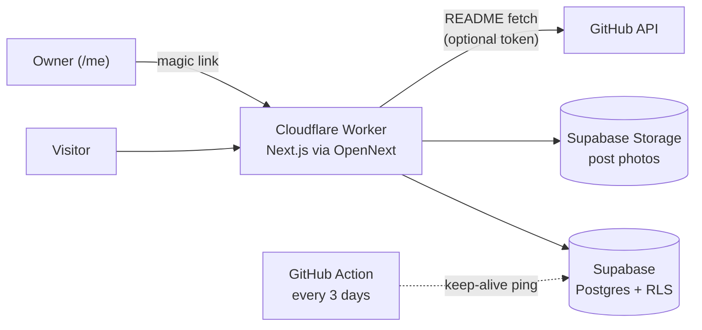

<div align="center">

# tarekferdous.me

**My personal portfolio and blog: projects, writing and contact details, plus a private admin area to manage it all.**
Project pages pull each repository's README straight from GitHub, so the portfolio stays in sync with the code.

**[→ Visit tarekferdous.me](https://tarekferdous.me)**


[](LICENSE)

</div>

---

## Features

**Public site**
- **Home page.** An intro card, a carousel of featured projects, a skills card, the latest posts and contact links.
- **Project pages** (`/projects/[slug]`). A hero section plus the project's README, fetched live from GitHub and rendered as GitHub-flavoured Markdown with sanitized HTML. Private repos work too, given a read-only token.
- **Blog** (`/posts`). Posts with cover images, excerpts and authors.
- **Comments.** Readers sign in with a magic link and can comment and vote on comments. Comments are moderated.
- Light and dark themes, a responsive layout, and glassy cards.

**Admin area** (`/me`, owner only)
- **Intro and contacts.** Edit the home page intro and contact links.
- **Projects.** Add projects, show or hide them, set a slug, background colour, summary and repo URL, and reorder them by drag and drop.
- **Posts.** A rich-text editor (TipTap) with photo uploads to Supabase Storage, plus drafts and publishing.
- **Comments.** A moderation queue.

## How it works



- **Rendering.** Next.js App Router with server components. Data is loaded in server actions (`lib/actions`) and pages render at the edge on Cloudflare Workers through the [OpenNext](https://opennext.js.org/cloudflare) adapter.
- **Security.** Supabase row-level security allows public reads of published content only. Admin writes are limited to the owner's email (`ADMIN_EMAIL`). Rendered README HTML is sanitized.
- **Keeping the database awake.** A scheduled GitHub Action pings Supabase every 3 days so the free-tier project doesn't pause.

## Getting started

**Requirements:** Node.js 20+, and a [Supabase](https://supabase.com) project.

```bash
git clone https://github.com/tarekFerdous/portfolio_vibe.git
cd portfolio_vibe
npm install
cp .env.example .env.local    # fill in the values below
npm run dev                   # http://localhost:3010
```

Apply the database schema by running the SQL files in [`supabase/migrations/`](supabase/migrations) in order, either with the Supabase CLI or in the SQL editor. They create the tables, RLS policies and storage buckets.

| Variable | Purpose |
|---|---|
| `NEXT_PUBLIC_SUPABASE_URL` / `NEXT_PUBLIC_SUPABASE_ANON_KEY` | Supabase project |
| `ADMIN_EMAIL` | The only email allowed into `/me` and to write content |
| `GITHUB_TOKEN` | Optional, server-only. A fine-grained, read-only token (Contents and Metadata) so project pages can render READMEs from private repos, and to raise the API rate limit |

For magic-link sign-in, add your site URL to **Supabase → Authentication → URL Configuration** (details in the deployment guide).

## Deployment

The site runs on **Cloudflare Workers** through OpenNext, with Workers Builds deploying from `main`.

```bash
npm run preview     # build with OpenNext and run locally on the Workers runtime
npm run deploy      # build and deploy
```

The full setup (custom domain, environment variables, Supabase redirect URLs) is in [`docs/deployment-cloudflare.md`](docs/deployment-cloudflare.md).

## Project layout

```
app/
  page.tsx                home: intro, projects carousel, skills, posts, contact
  projects/[slug]/        project page with live GitHub README
  posts/                  blog list + post pages with comments
  me/                     admin: intro, contacts, projects, posts editor, comment moderation
  auth/callback/          Supabase magic-link callback
components/               home, projects, comments, admin, navbar, ui (shadcn)
lib/
  actions/                server actions (Supabase reads and writes)
  github/                 README fetch, Markdown transform, repo URL parsing
  supabase/               server and browser clients
supabase/migrations/      schema, RLS policies, storage buckets
scripts/                  keep-alive ping, photo bucket migration, favicon processing
docs/                     deployment guide, agent docs
```

## Development

```bash
npm test          # Vitest + Testing Library (347 tests)
npm run lint
npm run pretty    # Prettier
npm run build
```

Contributor conventions (structure, TypeScript, Tailwind, shadcn components) are listed in [`CLAUDE.md`](CLAUDE.md) and `.cursor/rules/`.

## Credits and license

Started from the [PageAI](https://pageai.pro) Vibe Coding Starter template. The template and bundled libraries (shadcn/ui, Radix UI, Tailwind CSS, Lucide and others) are MIT/ISC licensed. Their notices are in [`LICENSE`](LICENSE).
